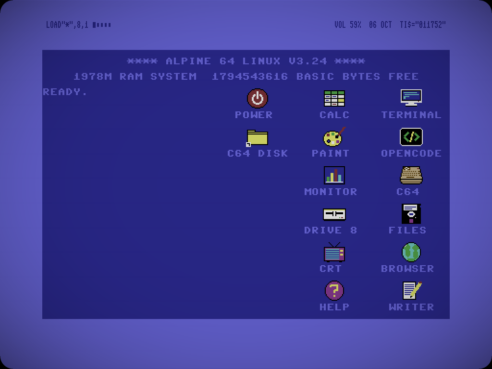
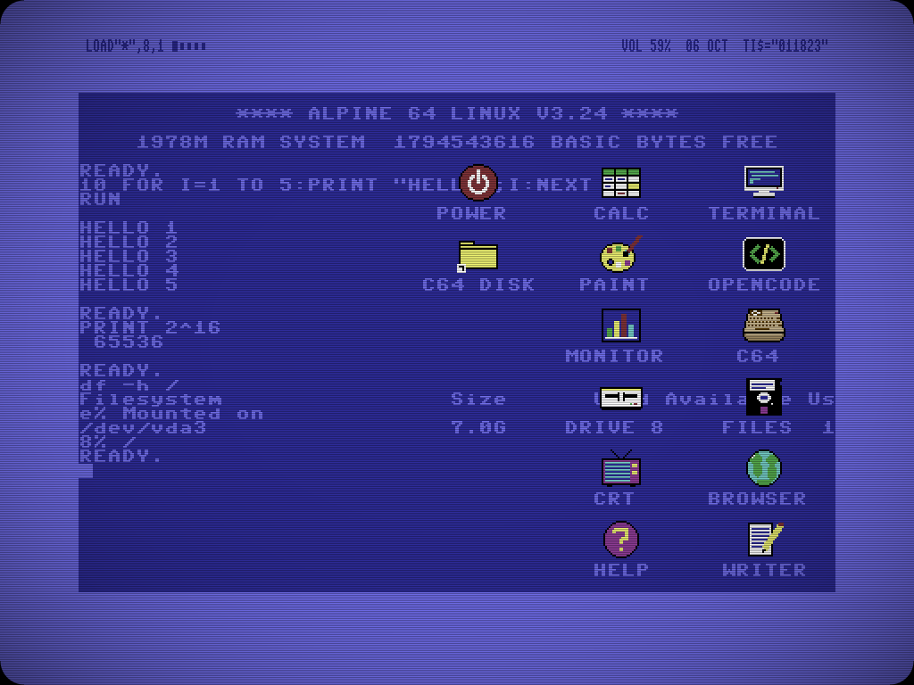
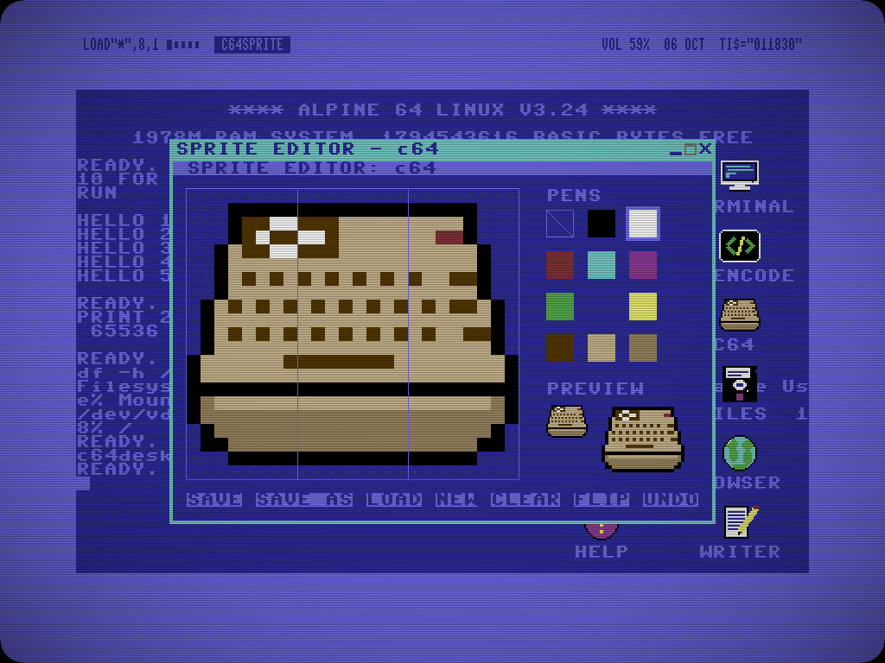
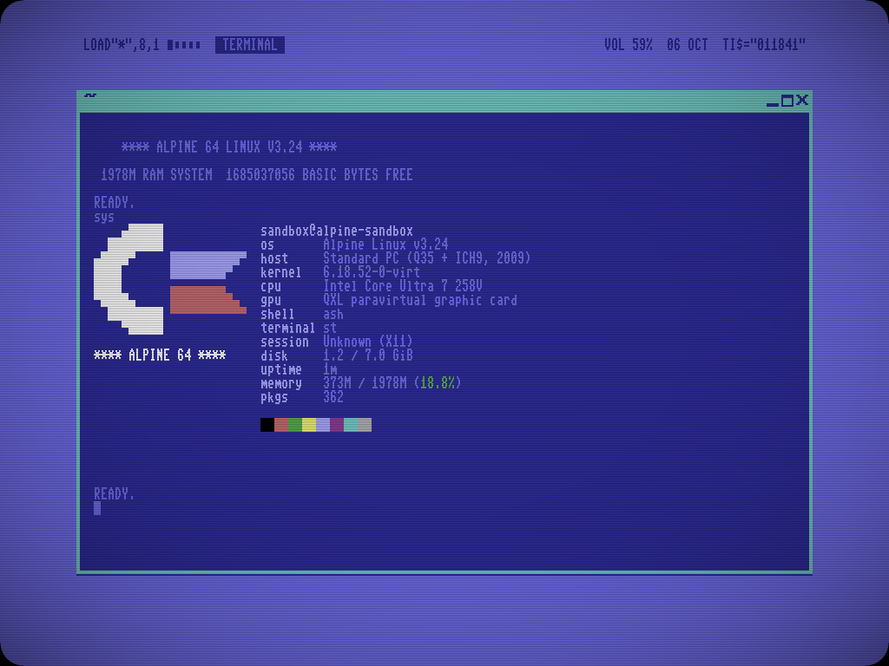
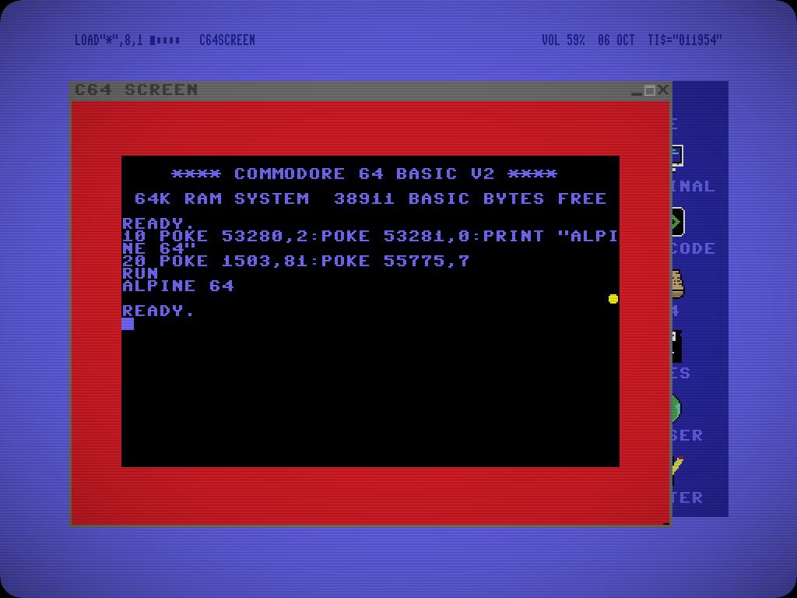

# C64pine

A Commodore 64 desktop for Linux -- Alpine, Debian, Ubuntu, Arch, Fedora ...: the light-blue border around the blue screen, the power-on banner,
`READY.` and a blinking cursor, chunky 8-colour sprite icons, a CRT filter with scanlines and rounded corners -- and a
desktop you can type on: shell commands run right there, and anything else goes to a real C64 BASIC.

## What you get

- **The desktop is `~/.c64pine/Desktop`**: apps (`.desktop` files), folders and files as 24x21 sprite icons on a 16 px grid.
  Drag to move, drop onto a folder to put things inside, drop files from the file manager to make shortcuts.
  Right-click menus, and a sprite **icon editor** (12 colours). Folders open as **folder windows** with the same
  icons, classic Mac style (one window per folder, remembered places; drag icons between windows and the desktop).
- **A command line on the desktop**: click and type. A line goes, in this order, to
  1. the desktop: `LOAD"TERMINAL",8,1`, `POKE 53280,2` (border colour), `SYS 64738`, `CD`, `CLS` ...
  2. the shell: `ls`, `cat`, `df` print on the desktop (with colours); `htop`, `mc`, `vim` open a terminal window
  3. **C64 BASIC** in VICE, out of sight: `10 PRINT "HELLO"`, `RUN`, `LIST`, `SAVE"PROG",8` ... its output appears on
     the desktop in C64 colours and PETSCII, and programs with graphics open the C64 SCREEN (VICE's own window, the
     same C64: the C64 icon opens it too; its X sends it back; Alt+D fullscreen; Alt+O VICE's settings).
- **CRT filter**: scanlines + vignette + rounded tube corners over the whole screen (picom), or only on the desktop.
- Openbox with a C64 theme, a top bar in the border (`LOAD"*",8,1` menu, 5 virtual desktops, window buttons, battery,
  network, `TI$` clock) that moves out of the way of windows, the Pet Me 64 font everywhere, st with the power-on
  banner and a `READY.` prompt, vfetch with the Commodore logo, PCManFM with C64 icons, and VICE.
- **A wallpaper engine**: any picture (or a folder of them, as a slideshow) shown in the blue screen as 320x200 in
  the 16 C64 colours, dithered, under the scanlines; the border takes the picture's colour (or one you pick).
- Media in the same colours: **cmus** (music), **mpv** (video), **nsxiv** (pictures), **zathura** (PDF), and
  **CAPTURE** (Print): screenshots of the screen, a window or an area, and recordings as video (+ sound, + mic),
  animated GIF or WebP. The colour presets (C64, C128, VIC-20, SX-64, PET green on black) and POKEs recolour the
  menus, dmenu, terminals, the file manager and these too.
- **Your own menus**: the desktop's right-click menu (cascading submenus: PROGRAMS, COLOURS, WALLPAPER, DESKTOPS with
  their windows), its PROGRAMS list and the `LOAD"*",8,1` finder are one plain file, arranged with the **MENUS** app.
- **Paste on the desktop** (ctrl+v): copied files land on the desktop; copied text is typed at the prompt, so a
  BASIC listing from a web page goes straight in.
- **Icons are 24x21 sprites** (PNG, in the C64 colours): edit them in the built-in icon editor (or any paint
  program); the system icon theme follows.
- C64 software: double-click a .d64, .t64, .prg, .c64, .tap or .crt and the same C64 loads and runs it in the C64
  SCREEN; closing that window ends it and the desktop's C64 comes back. The arrow keys are joystick 1 (fire = right
  Ctrl).
- **C64 LIBRARY**: folders with C64 software open as a cover view (covers in C64 colours, screenshot, description,
  year, author from Wikipedia / Wikidata; RUN, SEARCH, SCRAPE, SET your own).
- **C64.SAV**: the desktop's BASIC program is kept as a text listing on the desktop and comes back after a reboot.
- Bar popups: a calendar with reminders and the clock format, a volume slider, power settings with sleep / restart /
  shut down. Windows can be pinned (on top, every desktop) from the title bar.
- Archives: double-click extracts zip, rar, 7z, arj, lzh, cab, tar.* (7-Zip, bsdtar, ...); right-click to compress
  as zip, 7z, tar.gz or tar.xz; xarchiver in the file manager.
- On laptops: wifi/LAN (NetworkManager, `nmtui`), bluetooth (+ audio), brightness keys, suspend on lid close,
  touchpad tapping, external screens.
- `make-installer-iso`: builds a bootable installer ISO **of your system as it is** (desktop, icons, files included).

F1 shows the full cheat sheet (`c64pine/config/help-openbox.txt`). How much the hidden C64 costs (and when it costs nothing):
`docs/PERFORMANCE.md`.

| | |
|---|---|
|  |  |
|  |  |

## Install

### On the Linux you already have

    curl -fsSL https://raw.githubusercontent.com/zdanee/c64pine/main/get.sh | sh

(or from a clone: `git clone https://github.com/zdanee/c64pine && c64pine/installer/c64pine-install`)

Run it as your normal user. It is a blue C64-screen installer in the terminal that **shows everything before it does
anything**: what it found (system, package manager, login screen, your other desktops, sound), which parts you want,
and the full plan -- every package, every file outside your home -- then asks. It needs `sudo` or `doas` for the
packages and the login-screen entry, and asks for the password once.

- **One folder**: everything of C64pine goes into `~/.c64pine` (programs, settings, icons, its own Desktop and C64
  disk). Your `~/.config`, shell files, desktop and other sessions are not touched; inside C64pine your files are
  where they always were. To find its folders from your other desktops, the first session puts links in your home
  folder: `~/C64pine-Desktop`, `~/C64pine-C64Disk`, `~/C64pine-Screenshots`, `~/C64pine-Recordings` (delete
  any you don't want; they don't come back).
- **Next to what you have**: it adds an "C64PINE" entry to the login screen (tested with LightDM; GDM and SDDM read the same
  session folder; without a login screen: `startx ~/.c64pine/bin/c64-session`). Log out to go
  back to your usual desktop. Replacing the login screen with the C64 one (LightDM) is an opt-in part.
- **Undo**: `~/.c64pine/bin/c64pine uninstall` removes the login-screen entry, every recorded file, the home-folder links, and the packages
  it installed -- never one that something else needs -- and keeps the files you made in it (`~/c64pine-files`).
  On the test systems below the package list afterwards was exactly what it was before.
- **Anything missing from a distribution is built from source** into `~/.c64pine/opt`: VICE on Debian/Ubuntu (theirs
  comes without the C64 ROMs) and on Fedora (not packaged), cmus and nsxiv on Fedora. The compilers it needed are
  removed again at the end.
- `c64pine info` shows what is installed, `c64pine update` installs the newest version over it (your changed
  settings stay).

| tested on (with Xfce + LightDM) | packages | built from source |
|---|---|---|
| Debian 13 | apt | VICE |
| Arch Linux | pacman | -- |
| Fedora 43 | dnf | VICE, cmus, nsxiv |

Ubuntu/Mint (apt) and Alpine (apk) use the same paths; openSUSE, Void and others: the installer lists what is needed
and checks it, you install those packages yourself. C64pine is an X11 session: on a Wayland desktop it is simply
another entry at the login screen.

### A whole PC: the installer ISO (erases a disk)

Download `c64pine-*-x86_64.iso` from the releases, write it to a USB stick (`dd if=c64pine-*.iso of=/dev/sdX
bs=4M conv=fsync` on Linux, Rufus in "DD image" mode on Windows; Ventoy is known not to work on at least one machine),
boot it (legacy BIOS or UEFI, Secure Boot off), log in as `root` (no password) and run `c64-install`. The same blue
screens ask for the disk, computer name, user, password, keyboard layout, time zone and whether the desktop starts at
once or the C64 login screen asks, then it installs (MBR, EFI partition + ext4, swap file, GRUB for BIOS and UEFI;
offline, a few minutes).

### Try it first: the live ISO

`c64pine-live-*-x86_64.iso` boots straight into the desktop from a USB stick or CD (nothing is written to the disk;
changes are lost at power-off). The INSTALL icon (or `c64-install` in a terminal) installs it like the installer ISO.
Write it with `dd` / Rufus "DD image" too: booting it through Ventoy failed on at least one machine.

## Repository

| | |
|---|---|
| `c64pine/` | what becomes `~/.c64pine`: `bin/` (the session, bar, scripts), `config/` (Openbox, themes, apps), `data/` (sprites, icon theme, themes), `Desktop/` |
| `c64desk/` | the desktop program: `main.c` (window, CRT filter, bar placement), `items.c` (icons, drag & drop), `ui.c` (menus), `console.c` (the command line, shell jobs), `vice.c` (BASIC via VICE's binary monitor), `editor.c` (icon editor), `wallpaper.c` (the wallpaper engine; `stb_image.h` reads the pictures) |
| `greeter/` | `c64pine-greeter`: the C64 login screen for LightDM |
| `installer/` | `c64pine-install` (install / update / uninstall on any distribution), `tui.sh` (the blue screens, POSIX sh), `packages.list` (what is needed, per package manager), `src/` (source builds) |
| `get.sh` | the `curl ... \| sh` bootstrap: downloads this repository and starts the installer |
| `tools/gen-assets.py` | draws the sprites, the Openbox themes and the icon theme into `c64pine/data` (needs Pillow) |
| `patches/` | vfetch: the Commodore logo |
| `fonts/` | Pet Me 64 (Kreative Software, see `fonts/FreeLicense.txt`) |
| `system/` | the login-screen session entry, the root helper `c64-sys`, `make-installer-iso` and what it puts on the ISO: the installer (`install.sh`), `laptop.sh` (image conversion), `hardware.sh` (laptop extras), the laptop help |

## Licence

GPL-3.0 (`LICENSE`) for C64pine's own code and art. The fonts and the programs it builds or installs have their own
licences: see `CREDITS.md`. Unofficial fan project; "Commodore" is a trademark of its owner.
